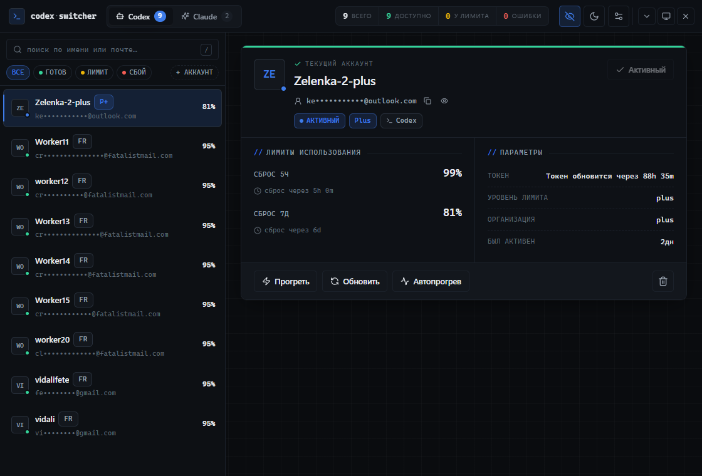

<div align="center">

# Codex Switcher

**Один переключатель для аккаунтов Codex, Claude Code и Z.ai.**
Упёрся в лимит — переключись на следующий аккаунт в один клик и работай дальше.

[English](README.md) · **Русский**

[](https://github.com/Kevanko/codex-switcher-fork/releases/latest)


</div>

## Быстрый старт

1. Скачай установщик из [последнего релиза](https://github.com/Kevanko/codex-switcher-fork/releases/latest):
   - Windows — `*_x64-setup.exe`
   - macOS — `*_aarch64.dmg` (Apple Silicon) или `*_x64.dmg`
   - Linux — `.AppImage`, `.deb` или `.rpm`
2. Добавь аккаунты на нужной вкладке:
   - **Codex** — вход через ChatGPT или импорт `~/.codex/auth.json`.
   - **Claude** — залогинься через `claude`, затем нажми **Добавить аккаунт** (или импортируй `~/.claude/.credentials.json`).
   - **Claude CLI** — долгоживущие токены из `claude setup-token`.
   - **Z.ai** — снимки входов в ZCode.
3. Выбери аккаунт → **Переключить**. Codex и ZCode перезапустятся сами, Claude Code перезапусти вручную.

Приложение обновляется само из релизов GitHub.

## Что умеет

| | Codex | Claude |
| --- | :---: | :---: |
| Лимиты за 5 часов и неделю с таймерами сброса | ✓ | ✓ |
| Переключение в один клик | ✓ | ✓ |
| Переключение из трея | ✓ | — |
| Бейджи подписки (Plus / Pro / Team, Pro / Max) | ✓ | ✓ |

А также: зашифрованный бэкап (`.cswf`), скрытие всех email одним переключателем, RU/EN, светлая/тёмная тема. Логины MCP-коннекторов в `.credentials.json` не трогаются при смене Claude-аккаунта.



## Сборка из исходников

Нужны Node.js 20+, pnpm и Rust stable.

```bash
git clone https://github.com/Kevanko/codex-switcher-fork.git
cd codex-switcher-fork
pnpm install
pnpm tauri dev      # запуск
pnpm tauri build    # установщики → src-tauri/target/release/bundle/
```

Релиз: `pnpm release:patch -- --push` — поднимает версию во всех файлах и пушит тег, остальное собирает GitHub Actions.

## Дисклеймер

Неофициальный проект, не связан с OpenAI, Anthropic или Z.ai. Используй только со своими аккаунтами: квоту он не добавляет и не предназначен для шаринга аккаунтов.
